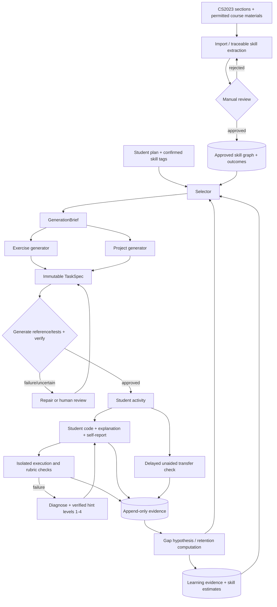

# `architect.md` — Socratix architecture & integration specification

## Implemented integration proposal — 2026-10-25

The user selected Supabase for **PostgreSQL and Auth**. See [ADR 0001](adr/0001-supabase-auth.md), [setup](database_setup.md) and [authentication](authentication.md). SQLAlchemy/Alembic access a private, non-Data-API `socratix` schema; the browser uses Supabase only for Auth. Global catalogue review is admin-only in this sample. Use `uvicorn app.main:create_configured_app --factory` for configured startup. Other component algorithms and isolated grading are not implemented by this foundation. Review status: Proposed.

**Owner / approver:** Member F (Full-stack & Integration). **Contract:** [shared_contracts.md](shared_contracts.md) v1.0. **Status:** proposed for MVP. Changes to system boundaries need owner approval from all impacted components.

## Proposed operator import bridge

The offline PDF CLI exports evidence; `src/scripts/import_skills.py` validates selected units,
calls the shared gateway sequentially, checkpoints validated chunks and commits whole units as
pending catalogue revisions. Member F's import repository owns source/span/ledger writes. A
session advisory lock serializes the same fingerprint; no transaction spans provider calls.
Human review remains the only publication path. No upload route or worker is introduced.
Database/auth and the lazy gateway coexist in FastAPI's lifecycle. See [runbook](skill_import_bridge.md)
and [proposed ADR](adr/0003-durable-skill-import.md). Migration 0006 and additive evidence DTO
await A/F review; hosted end-to-end operation is not claimed.

## Mission and scope

Proposed recovery reads inactive matching checkpoints and requires explicit choices for semantic
conflicts/evidence repairs. It performs zero model requests, uses the existing ledger for an
auditable derived run, and keeps publication under the existing human review service. See
[saved proposal recovery](skill_import_recovery.md). No new API, table or approval policy is added.

Socratix helps Informatics students become **independent problem solvers** through diagnostic recall → understanding → transfer, verified personalised exercises and projects, four-stage Socratic assistance, reflective planning, and delayed unaided reassessment. Optimize for subsequent unassisted performance, **not** for number of tasks solved with AI.

**Included MVP:** CS2023-inspired skill graph with human approval; student-selected planning tags; proposed 40/35/25 selection heuristic; single- and multi-skill Python exercises; milestone-based Python projects; isolated grading; adaptive four-level hints; evidence-based gap estimates; manual review; Next.js frontend; FastAPI + ELM; Supabase PostgreSQL.

**Excluded MVP:** institutional gradebook sync, unrestricted course PDF scraping, automatic high-stakes grading, unreviewed skill publication, model fine-tuning or reinforcement learning, unfettered execution of arbitrary user code on Render API hosts.

## Conceptual components (read in plain language)

- **Skill catalogue:** the library of teachable abilities. CS2023 provides knowledge areas/units/topics/outcomes; Socratix subdivides them into assessable skills.
- **Skill graph:** `part_of` gives hierarchy; `requires` gives prerequisite edges; `related_to` records associations. A taxonomy (tree/hierarchy) and prerequisite network are **not the same**.
- **Selector:** chooses an activity target from planning, suspected gaps, and retention; recommendations are explainable and overridable.
- **Generators:** write a structured task contract before solutions/tests. Exercise and project generators are different services sharing a common generation brief.
- **Verification:** automatically tests expected functionality and rules; uses a human review path for uncertainty and subjective learning outcomes.
- **Tutor:** uses actual execution evidence and student explanations to decide a four-stage hint; stage 4 may reveal an answer and invalidates independent mastery attribution for that attempt.
- **Evidence engine:** appends observations and derives confidence-labelled skill gap estimates. No single error proves a misconception.

## Overview (logical modules, not seven servers)



## Runtime & deployment

| Layer | Choice | Deployment boundary / trust |
|---|---|---|
| Web | Next.js App Router, TypeScript | Vercel; no ELM keys, grading references or DB credentials in browser. |
| API | FastAPI, Pydantic, SQLAlchemy, Alembic | Render public web service; auth, CORS, task orchestration, review endpoints. |
| Model integration | `src/backend/app/integrations/elm.py` | Server-side OpenAI Python SDK pattern with **configurable ELM base URL/model**; no model-specific code elsewhere. |
| Database | PostgreSQL | Supabase; TLS, connection pooling, versioned migrations. |
| Long-running jobs | Job table + dedicated worker, broker as needed | Render background worker, separate from public API. Avoid jobs tied to a short web request. |
| Code checking | **Sandbox worker** with subprocess/container isolation | Separate constrained infrastructure; no raw `exec` in API, no network by default, resource limits, unprivileged process, no secrets. Validate hosted sandbox feasibility and security before enabling student execution. |
| Artifact storage | Database metadata + private object storage if needed | No hidden tests/solutions in public assets. Define storage provider before large files. |

### ELM integration verification checklist

**Proposed implementation (2026-10-25):** the shared adapter supports configured compatible
Chat Completions endpoints, plain text and locally validated JSON. LLM-only settings and
the standalone request CLI do not require DB/Auth. See [integration setup](llm_integration.md)
and [proposed ADR](adr/0001-compatible-llm-gateway.md). Provider capabilities still require
credentialed verification. Other backend domain services remain scaffolded.

The [University ELM Python examples](https://information-services.ed.ac.uk/computing/elm/elm-competence-centre/examples-of-how-to-use-elm-with-python-and-elm-api-key/interacting-with-elm-using-python-and-the-elm-api) use the OpenAI SDK, `OPENAI_BASE_URL`, API key and chat completions. Its [model list](https://information-services.ed.ac.uk/computing/elm/elm_competence_centre/elm-models-available-through-the-api) says available models depend on account permissions. The [Swagger UI](https://elm.edina.ac.uk/swagger-ui/index.html) is the live reference; its full OpenAPI details were **not verifiable here**.

Member F must implement a credentialed smoke test: (1) resolve model IDs or call `/models` if supported, (2) test chat completion, (3) request JSON and validate, (4) test streaming only if needed, (5) check rate limits/usage/timeout/error structure, (6) check whether structured response formats are accepted, (7) record **actual supported endpoints and permissions** in an integration ADR. Do not invent `ELM_API_URL` or assume ELM supports OpenAI Responses API or tool calling.

Suggested environment names (application-owned, not provider facts): `ELM_API_KEY`, `ELM_BASE_URL`, `ELM_MODEL_GENERATION`, `ELM_MODEL_REVIEW`, `DATABASE_URL`, `WEB_ORIGIN`, `JOB_QUEUE_URL`, `JWT_ISSUER`, `JWT_AUDIENCE`, `SANDBOX_SERVICE_URL`, `GENERATION_MAX_RETRIES`. Configure via Render/Vercel secrets; never commit values. Database URLs use `sslmode=require` for encrypted connections without a local CA-file requirement.

## Primary flows and integration contracts

1. **Import:** approved CS2023 source excerpt/locator → deterministic hierarchy extraction where possible → LLM proposes fine-grained skills/outcomes/prerequisites → graph validation → human approval → publish stable IDs. See [skill_generation.md](skill_generation.md).
2. **Student planning:** student writes plan → LLM suggests canonical skill tags with evidence → student confirms → `student_plans`. See [planning_reflection_to_skills.md](planning_reflection_to_skills.md).
3. **Select:** using confirmed plan tags, gap indices and due-retention indices, calculate fixed `0.40 plan + 0.35 gap + 0.25 retention` score **only after eligibility filtering**; student may override. See [exercise_project_selector.md](exercise_project_selector.md).
4. **Generate exercise:** `GenerationBrief` → LLM specification → frozen contract → independent reference/test generation → deterministic tests + review → verified/published `TaskSpec`. Support `single_skill_exercise`, `multi_skill_exercise` with integrated outcomes and three stages. See [exercise_generation.md](exercise_generation.md).
5. **Generate project:** `GenerationBrief` → `ProjectSpec` → milestones, tested public interfaces and design rubrics → validation and review. See [project_generation.md](project_generation.md).
6. **Submit:** authenticated student code → constrained runner → `EvaluationResult` → verified failure diagnostics → progressive hints and retries. See [hinting.md](hinting.md).
7. **Assess and reflect:** each attempt, hint, student confidence and reflection → append-only evidence → gap hypotheses; delayed no-assistance transfer creates strong retention evidence. See [knowledge_gap_identification.md](knowledge_gap_identification.md).
8. **Re-select:** selector consumes fresh derived estimates and offers the next activity; no silent plan override.

## Shared module boundaries — no direct cross-component DB writes

| Producer | Consumer | Contract | Transport |
|---|---|---|---|
| Skill Import (A) | Selector/Generators (B,C,D) | Approved `Skill`, `Outcome`, directed `SkillRelation` | Repository query / service method |
| Planning (D) | Selector (D) | `PlanTagsConfirmed` | Function + DB |
| Selector (D) | Generators (B,C) | `GenerationBrief` | Typed function or job payload |
| Exercise/Project (B,C) | Grading/Tutor (E) | Immutable task contract + **private** test refs | Internal job/DB lookup |
| Grading (E) | Gap (D) | `AssessmentEvidence` with validity & assistance | Append-only event |
| Gap (D) | Selector (D) | `SkillEstimate` and retention-due indices | Query/read model |
| All services | Web (F) | `/api/v1` DTOs | JSON over HTTPS |

**Rule:** Only Member F/DB owner can modify migrations; other developers propose schema updates and adapt to accepted migrations. Agents must not bypass service boundaries by reading private solution tables from student APIs.

## Human-review policy

| Candidate | Automated check | Human gate |
|---|---|---|
| New/changed skill or prerequisite | source trace, schema, cycle/duplicate check | Must be approved before entering canonical graph |
| New learning outcome | ID and source checks | Approve during import/curation |
| Low-stakes coding exercise | reference passes tests, mutation/boundary checks, concept alignment | Review if uncertainty or failed/weak QA; optionally sample accepted items |
| Project architecture rubric | requirement consistency and milestone graph checks | Review before releasing first new project family, and high-stakes tasks |
| Suggested knowledge gap | evidence thresholds and provenance | Suspected until repeated evidence; human verification path (instructor/student challenge) |
| Final grading/academic consequences | evidence reports | Human/institution-approved policy required |

## Provisional heuristics and limitations

- The **40/35/25 selector weights are proposed design defaults, not user-specified or validated values**. They are a convenience for a testable MVP, not optimal values. Log features and version; adapt after evaluation.
- The gap prioritisation thresholds (see component doc) are **uncalibrated** and may be biased by question difficulty, hint accessibility, language proficiency, disability, time pressure, experience and grader mistakes.
- A reported confidence level is helpful but can be miscalibrated. A hint-heavy success is not equivalent to unaided success. Invalid tests do not update mastery.
- CS2023 is a copyright-protected guideline. Public availability does not grant blanket rights to bulk redistribution or commercial AI ingestion. Use only permitted material; keep provenance and approval trail; obtain permission if needed.
- **Future:** experiment with contextual bandits/RL to choose exercises/hints based on **later unaided transfer success** using consented data, preregistered evaluation, sufficient sample size and safety/ethics review. Do not include learning-to-rank weights as self-updating in MVP.

## Repository layout (monorepo)

The directory scaffold is under `src/`. See the [source map](../src/README.md) for full ownership, route-file assignments and component guides. This changes physical paths only; the API contracts and runtime trust boundaries stay as specified above.

```text
Socratix/
|-- README.md
|-- AGENTS.md
|-- docs/                            Engineering specifications
|-- data/                            Source material, separate from application code
|-- src/
|   |-- README.md                    Source map and ownership guide
|   |-- backend/                     FastAPI and trusted background-job orchestration
|   |   |-- app/
|   |   |   |-- api/v1/               Separate handlers per owner; F registers routers
|   |   |   |-- contracts/            F: canonical DTOs, enums and protocols
|   |   |   |-- core/                 F: configuration, auth, errors and logging
|   |   |   |-- db/                   F: ORM models, sessions and shared adapters
|   |   |   |-- integrations/         ELM adapter (F), grading transport (E)
|   |   |   `-- modules/
|   |   |       |-- skill_generation/ A / JK
|   |   |       |-- exercise_generation/ B
|   |   |       |-- project_generation/ C
|   |   |       |-- selector/         D
|   |   |       |-- knowledge_gap/    D
|   |   |       |-- planning/         D
|   |   |       `-- hinting/          E
|   |   |-- migrations/versions/      F: reviewed Alembic migrations
|   |   |-- workers/                  F: dispatch and composition, not code execution
|   |   `-- tests/{unit,contract,integration}/<component>/
|   |-- frontend/                    F: Next.js application, own dependencies/build
|   |   |-- src/{app,components,hooks,lib,types/generated}/
|   |   `-- tests/{unit,component,e2e}/
|   |-- grading-worker/              E: separate isolated executor
|   |   |-- runner/
|   |   `-- tests/
|   |-- shared/{prompts,fixtures,openapi}/
|   |-- scripts/                     F: repository integration tooling
|   `-- deployment/                  F: deployment configuration and notes
`-- .github/workflows/               Future CI workflows remain at the repository root
```

Each backend test tier has one directory per component plus `infrastructure/` for F's shared checks. Prompts are partitioned by owner under `src/shared/prompts/`. The component specifications list planned implementation file names; these files are added incrementally, not as empty generic functions.

Set deployment roots to `src/frontend`, `src/backend` and `src/grading-worker` respectively. The backend generation worker and the isolated grading worker remain different processes and trust boundaries. Shared development resources must not be copied into browser assets. Database/review manifests, entry points, migrations and generated contracts are implemented; worker dispatch, grading infrastructure and deployment provisioning remain separate work.

## Integration and deployment checklist

- [ ] Pick and verify one ELM model permitted by API key; record endpoint/JSON fallback behaviour.
- [ ] Approve exact CS2023 extracts/rights and canonical concept IDs.
- [ ] FastAPI OpenAPI is source of truth; generate TS client; CI rejects contract drift.
- [ ] Implement auth + per-student ACLs; roles `student`, `instructor`, `admin`.
- [ ] Set up Supabase PostgreSQL using the standard `postgresql://` URL; shared settings select psycopg and require TLS automatically. Alembic migrations run once during deploy, not on each web worker start.
- [ ] Render API binds `0.0.0.0:$PORT`, has `/healthz`, locked CORS for Vercel frontend.
- [ ] Configure worker job timeouts/idempotency; no grading or large LLM jobs in API request thread.
- [ ] Isolated grading worker has no application DB admin credentials/ELM key, no outbound network by default, CPU/memory/filesystem/process/time limits.
- [ ] Vercel environment only exposes `NEXT_PUBLIC_API_BASE_URL`, never ELM/DB/hidden-test secrets.
- [ ] E2E dry run: manual approve a skill → exercise → tests → submission → hint → evidence → next selection.
- [ ] Simulate task QA failure and ensure **no incorrect mastery update**.
- [ ] Log model/prompt/schema/policy versions, tracing IDs, errors and costs; avoid logging raw personal work when unnecessary.
- [ ] Make manual review inbox functional before broad automated publishing.

## Suggested delivery plan

**Milestone A:** Member F merges shared contracts + DB baseline. Member A seeds a curated graph. **Milestone B:** Member B delivers verified one-skill exercise, Member E grades in isolation. **Milestone C:** Member D adds recommendations and gap estimates from fixture evidence; Member F displays full loop. **Milestone D:** Member C delivers one project with verified milestones, Member E delivers four-level hints, then integrate delayed transfer assessment. Each milestone has contract tests and a short demo.

## External references

- [Official CS2023](https://csed.acm.org/)
- [Edinburgh ELM developer example](https://information-services.ed.ac.uk/computing/elm/elm-competence-centre/examples-of-how-to-use-elm-with-python-and-elm-api-key/interacting-with-elm-using-python-and-the-elm-api)
- [Render web service deployment](https://render.com/docs/web-services)
- [Render background workers](https://render.com/docs/background-workers)
- [Supabase SSL enforcement](https://supabase.com/docs/guides/platform/ssl-enforcement)
- [Next.js deployment](https://nextjs.org/docs/app/getting-started/deploying)

## Design-change governance (mandatory for the component owner and coding agents)

This document is the **current approved design**, not a disposable prompt. If implementation requires a different algorithm, workflow, schema, API payload, prompt contract, task policy, or project milestone design:

1. Start or continue work on your personal feature branch (`<INITIALS>/<feature_name>`); never modify `main` directly.
2. Before implementing a design deviation, record a proposal in `docs/changes/CHANGELOG.md` with the date, branch, owner, **before → after**, reason, affected files/interfaces, migration/test consequences and review status. For a significant cross-component decision, additionally write `docs/adr/NNNN-short-decision.md` (template provided).
3. Update **this component MD** to describe the newly proposed/approved behaviour. If the change touches boundaries, also update `docs/shared_contracts.md`; if it changes the overall flow, update `docs/architect.md`; for DB schemas, update `docs/database.md`; for UI behaviour, update `docs/web_design.md`. Do not silently change unrelated modules' specifications.
4. Update or add tests and include the changed Markdown files **in the same pull request as the code**. Cross-component contract changes need review from Member F and each affected owner. Changes to approved academic rules or evaluation policy need the designated human reviewer.
5. Until reviewed and merged, label the new design **Proposed** in the log; accepted design replaces the active description only upon team approval. Keep the historical before/after entry; never rewrite it.
6. Coding agents must propose changes rather than autonomously approving architectural, grading, or mastery-policy changes.

See [repository team rules](../README.md), [agent rules](../AGENTS.md), and [change-log template](changes/CHANGELOG.md). Ordinary typo or formatting fixes can be noted in the PR without a design-change entry.
