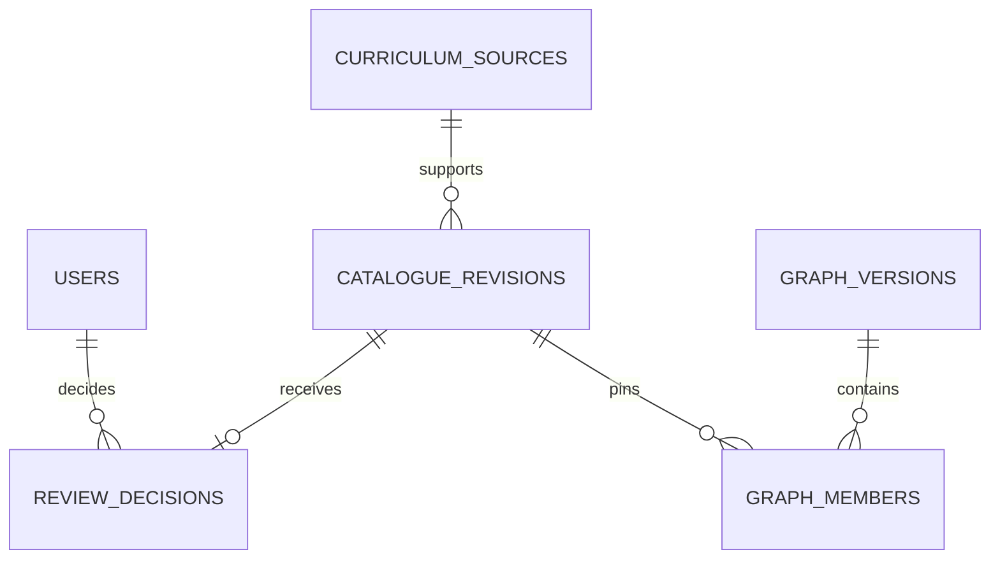
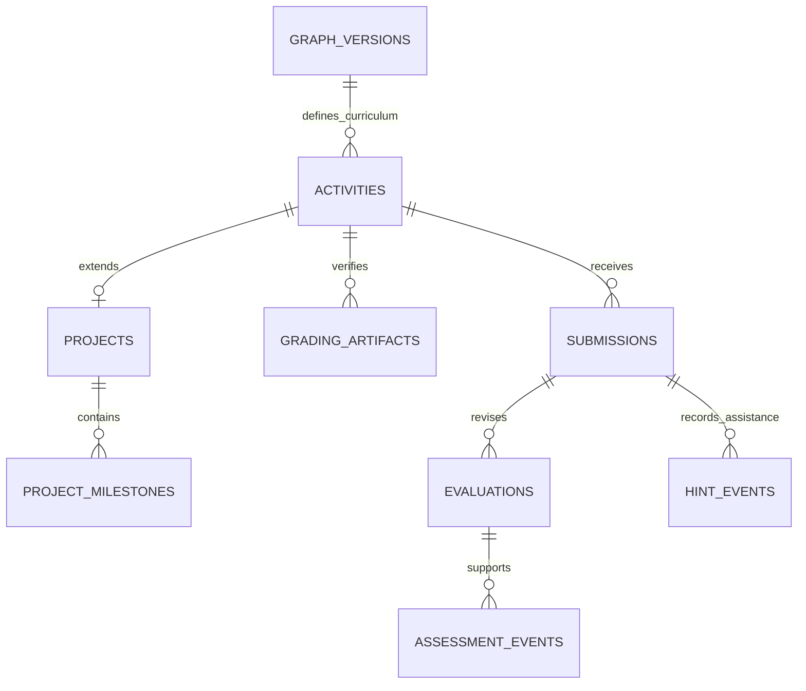

# Physical database dictionary

Generated by `src/scripts/generate_schema_docs.py`. Rationale and workflows: [database.md](database.md).

**Status:** implemented initial schema; proposed pending Member F/affected-owner review. Hosted execution is not implied.

All tables use the private `socratix` schema. UUID identifiers reference application users, never Supabase-managed Auth tables. Foreign keys restrict deletion unless explicitly noted. JSONB structure is validated by the owning application boundary.

## Physical relationship overview

Selected workflows below use actual table foreign keys. Composite key details are listed for each table.

## activities

Versioned student-safe task/project contracts pinned to an approved graph. Freeze before private QA generation.

Schema owner: Member F; domain access follows the ownership map in database.md. All direct SQL access is backend-only; private learner rows require owner checks. Audit/history records are append-only; activity children freeze with their parent; derived models and job state remain mutable.

| Column | SQL type | Nullable | Key / default |
|---|---|---|---|
| `id` | `UUID` | no | PK |
| `version` | `INTEGER` | no | PK |
| `student_id` | `UUID` | no | FK → `users.id` |
| `course_id` | `UUID` | no | FK → `courses.id` |
| `activity_type` | `VARCHAR` | no | — |
| `status` | `VARCHAR` | no | server default `draft` |
| `human_review_status` | `VARCHAR` | no | server default `pending` |
| `student_safe_spec` | `JSONB` | no | — |
| `spec_checksum` | `VARCHAR` | no | — |
| `generation_policy_version` | `VARCHAR` | no | — |
| `graph_version` | `INTEGER` | no | FK → `graph_versions.graph_version` |
| `frozen_at` | `TIMESTAMP WITH TIME ZONE` | yes | — |
| `published_at` | `TIMESTAMP WITH TIME ZONE` | yes | — |
| `created_at` | `TIMESTAMP WITH TIME ZONE` | no | server default `now()` |

Constraints and query indexes:

- `ck_activities_activity_type_values`: `activity_type IN ('single_skill_exercise','multi_skill_exercise','project')`
- `ck_activities_frozen_before_verification`: `status NOT IN ('verifying','verified','published') OR frozen_at IS NOT NULL`
- `ck_activities_human_review_status_values`: `human_review_status IN ('not_required','pending','approved','rejected')`
- `ck_activities_positive_version`: `version >= 1`
- `ck_activities_publication_review_gate`: `status <> 'published' OR human_review_status IN ('approved','not_required')`
- `ck_activities_status_values`: `status IN ('draft','verifying','review_required','verified','published','rejected','archived')`
- Foreign key `(course_id)` → `(courses.id)`
- Foreign key `(graph_version)` → `(graph_versions.graph_version)`
- Foreign key `(student_id)` → `(users.id)`
- Unique: `id, version, student_id`

## activity_outcomes

Target and engineering outcomes of one exact activity version.

Schema owner: Member F; domain access follows the ownership map in database.md. All direct SQL access is backend-only; private learner rows require owner checks. Audit/history records are append-only; activity children freeze with their parent; derived models and job state remain mutable.

| Column | SQL type | Nullable | Key / default |
|---|---|---|---|
| `activity_id` | `UUID` | no | PK; FK → `activities.id` |
| `activity_version` | `INTEGER` | no | PK; FK → `activities.version` |
| `outcome_id` | `VARCHAR` | no | PK; FK → `learning_outcomes.outcome_id` |
| `outcome_role` | `VARCHAR` | no | — |

Constraints and query indexes:

- `ck_activity_outcomes_outcome_role_values`: `outcome_role IN ('target','engineering')`
- Foreign key `(activity_id, activity_version)` → `(activities.id, activities.version)`
- Foreign key `(outcome_id)` → `(learning_outcomes.outcome_id)`

## activity_skills

Target skills of one exact activity version.

Schema owner: Member F; domain access follows the ownership map in database.md. All direct SQL access is backend-only; private learner rows require owner checks. Audit/history records are append-only; activity children freeze with their parent; derived models and job state remain mutable.

| Column | SQL type | Nullable | Key / default |
|---|---|---|---|
| `activity_id` | `UUID` | no | PK; FK → `activities.id` |
| `activity_version` | `INTEGER` | no | PK; FK → `activities.version` |
| `skill_id` | `VARCHAR` | no | PK; FK → `skills.skill_id` |

Constraints and query indexes:

- Foreign key `(activity_id, activity_version)` → `(activities.id, activities.version)`
- Foreign key `(skill_id)` → `(skills.skill_id)`

## assessment_events

Append-only objective, assistance, self-report and correction history. Invalid/uncertain tests do not derive mastery.

Schema owner: Member F; domain access follows the ownership map in database.md. All direct SQL access is backend-only; private learner rows require owner checks. Audit/history records are append-only; activity children freeze with their parent; derived models and job state remain mutable.

| Column | SQL type | Nullable | Key / default |
|---|---|---|---|
| `evidence_id` | `UUID` | no | PK; application-generated default |
| `student_id` | `UUID` | no | FK → `submissions.student_id`; FK → `users.id` |
| `attempt_id` | `UUID` | yes | FK → `submissions.attempt_id`; FK → `evaluations.attempt_id` |
| `evaluation_id` | `UUID` | yes | FK → `evaluations.evaluation_id` |
| `skill_id` | `VARCHAR` | no | FK → `learning_outcomes.skill_id`; FK → `skills.skill_id` |
| `outcome_id` | `VARCHAR` | yes | FK → `learning_outcomes.outcome_id` |
| `stage` | `VARCHAR` | yes | — |
| `event_type` | `VARCHAR` | no | — |
| `task_validity` | `VARCHAR` | yes | — |
| `observed_correctness` | `FLOAT` | yes | — |
| `independent` | `BOOLEAN` | yes | — |
| `max_hint_level_used` | `INTEGER` | no | server default `0` |
| `solution_revealed` | `BOOLEAN` | no | server default `false` |
| `student_confidence` | `FLOAT` | yes | — |
| `feedback` | `TEXT` | yes | — |
| `corrects_evidence_id` | `UUID` | yes | FK → `assessment_events.evidence_id` |
| `occurred_at` | `TIMESTAMP WITH TIME ZONE` | no | application-generated default |

Constraints and query indexes:

- `ck_assessment_events_confidence_range`: `student_confidence BETWEEN 0 AND 1`
- `ck_assessment_events_correction_reference`: `(event_type = 'correction') = (corrects_evidence_id IS NOT NULL)`
- `ck_assessment_events_correctness_range`: `observed_correctness BETWEEN 0 AND 1`
- `ck_assessment_events_event_type_values`: `event_type IN ('assessment','self_report','assistance','correction')`
- `ck_assessment_events_hint_range`: `max_hint_level_used BETWEEN 0 AND 4`
- `ck_assessment_events_independent_unassisted`: `independent IS NOT TRUE OR (solution_revealed = false AND max_hint_level_used = 0)`
- `ck_assessment_events_objective_evidence_refs`: `event_type <> 'assessment' OR (evaluation_id IS NOT NULL AND attempt_id IS NOT NULL AND outcome_id IS NOT NULL AND stage IS NOT NULL AND task_validity IS NOT NULL)`
- `ck_assessment_events_self_report_not_objective`: `event_type = 'assessment' OR observed_correctness IS NULL`
- `ck_assessment_events_stage_values`: `stage IN ('recall','understanding','transfer')`
- `ck_assessment_events_task_validity_values`: `task_validity IN ('valid','invalid','uncertain')`
- Foreign key `(attempt_id, student_id)` → `(submissions.attempt_id, submissions.student_id)`
- Foreign key `(corrects_evidence_id)` → `(assessment_events.evidence_id)`
- Foreign key `(evaluation_id, attempt_id)` → `(evaluations.evaluation_id, evaluations.attempt_id)`
- Foreign key `(outcome_id, skill_id)` → `(learning_outcomes.outcome_id, learning_outcomes.skill_id)`
- Foreign key `(skill_id)` → `(skills.skill_id)`
- Foreign key `(student_id)` → `(users.id)`
- Unique: `evaluation_id, outcome_id`
- Index `ix_assessment_student_skill_time`: `student_id, skill_id, occurred_at`

## catalogue_revisions

Immutable candidate payloads and separately mutable approval state. Source_id binds provenance.

Schema owner: Member F; domain access follows the ownership map in database.md. All direct SQL access is backend-only; private learner rows require owner checks. Audit/history records are append-only; activity children freeze with their parent; derived models and job state remain mutable.

| Column | SQL type | Nullable | Key / default |
|---|---|---|---|
| `resource_type` | `VARCHAR` | no | PK |
| `resource_id` | `VARCHAR` | no | PK |
| `resource_version` | `INTEGER` | no | PK |
| `approval_status` | `VARCHAR` | no | — |
| `payload` | `JSONB` | no | — |
| `checksum` | `VARCHAR` | no | — |
| `source_id` | `UUID` | no | FK → `curriculum_sources.id` |
| `created_by` | `UUID` | no | FK → `users.id` |
| `created_at` | `TIMESTAMP WITH TIME ZONE` | no | server default `now()` |

Constraints and query indexes:

- `ck_catalogue_revisions_approval_status_values`: `approval_status IN ('proposed','under_review','approved','rejected')`
- `ck_catalogue_revisions_positive_version`: `resource_version >= 1`
- `ck_catalogue_revisions_resource_type_values`: `resource_type IN ('skill','relation','outcome')`
- Foreign key `(created_by)` → `(users.id)`
- Foreign key `(source_id)` → `(curriculum_sources.id)`
- Index `ix_catalogue_pending`: `approval_status, created_at, resource_id`

## course_enrolments

Course membership used for learner and instructor authorisation.

Schema owner: Member F; domain access follows the ownership map in database.md. All direct SQL access is backend-only; private learner rows require owner checks. Audit/history records are append-only; activity children freeze with their parent; derived models and job state remain mutable.

| Column | SQL type | Nullable | Key / default |
|---|---|---|---|
| `user_id` | `UUID` | no | PK; FK → `users.id` |
| `course_id` | `UUID` | no | PK; FK → `courses.id` |
| `course_role` | `VARCHAR` | no | — |
| `status` | `VARCHAR` | no | server default `active` |
| `enrolled_at` | `TIMESTAMP WITH TIME ZONE` | no | application-generated default |

Constraints and query indexes:

- `ck_course_enrolments_course_role_values`: `course_role IN ('student','instructor')`
- `ck_course_enrolments_status_values`: `status IN ('active','inactive')`
- Foreign key `(course_id)` → `(courses.id)`
- Foreign key `(user_id)` → `(users.id)`

## course_skills

Per-course availability without declaring a skill universally taught.

Schema owner: Member F; domain access follows the ownership map in database.md. All direct SQL access is backend-only; private learner rows require owner checks. Audit/history records are append-only; activity children freeze with their parent; derived models and job state remain mutable.

| Column | SQL type | Nullable | Key / default |
|---|---|---|---|
| `course_id` | `UUID` | no | PK; FK → `courses.id` |
| `skill_id` | `VARCHAR` | no | PK; FK → `skills.skill_id` |
| `taught_week` | `INTEGER` | yes | — |
| `availability` | `VARCHAR` | no | — |
| `approval_status` | `VARCHAR` | no | — |

Constraints and query indexes:

- `ck_course_skills_approval_status_values`: `approval_status IN ('proposed','under_review','approved','rejected')`
- `ck_course_skills_availability_values`: `availability IN ('available','planned','unavailable')`
- `ck_course_skills_positive_week`: `taught_week IS NULL OR taught_week >= 1`
- Foreign key `(course_id)` → `(courses.id)`
- Foreign key `(skill_id)` → `(skills.skill_id)`

## courses

Course catalogue and lifecycle metadata.

Schema owner: Member F; domain access follows the ownership map in database.md. All direct SQL access is backend-only; private learner rows require owner checks. Audit/history records are append-only; activity children freeze with their parent; derived models and job state remain mutable.

| Column | SQL type | Nullable | Key / default |
|---|---|---|---|
| `id` | `UUID` | no | PK; application-generated default |
| `code` | `VARCHAR` | no | — |
| `name` | `VARCHAR` | no | — |
| `description` | `TEXT` | no | — |
| `status` | `VARCHAR` | no | server default `active` |
| `updated_at` | `TIMESTAMP WITH TIME ZONE` | no | server default `now()` |
| `created_at` | `TIMESTAMP WITH TIME ZONE` | no | server default `now()` |

Constraints and query indexes:

- `ck_courses_status_values`: `status IN ('active','archived')`
- Unique: `code`

## curriculum_sources

Source provenance and explicit rights review; permitted sources may support approval.

Schema owner: Member F; domain access follows the ownership map in database.md. All direct SQL access is backend-only; private learner rows require owner checks. Audit/history records are append-only; activity children freeze with their parent; derived models and job state remain mutable.

| Column | SQL type | Nullable | Key / default |
|---|---|---|---|
| `id` | `UUID` | no | PK; application-generated default |
| `source_kind` | `VARCHAR` | no | — |
| `uri` | `TEXT` | no | — |
| `section` | `VARCHAR` | yes | — |
| `edition` | `VARCHAR` | yes | — |
| `checksum` | `VARCHAR` | no | — |
| `rights_status` | `VARCHAR` | no | — |
| `extraction_model` | `VARCHAR` | yes | — |
| `fetched_at` | `TIMESTAMP WITH TIME ZONE` | no | application-generated default |
| `created_at` | `TIMESTAMP WITH TIME ZONE` | no | server default `now()` |

Constraints and query indexes:

- `ck_curriculum_sources_rights_status_values`: `rights_status IN ('pending','permitted','restricted')`
- `ck_curriculum_sources_source_kind_values`: `source_kind IN ('cs2023','course_material','exercise','instructor','ai_proposed')`
- Unique: `checksum`

## evaluations

Append-only grader revisions. Repeated target keys enforce that the private artifact matches the attempt version.

Schema owner: Member F; domain access follows the ownership map in database.md. All direct SQL access is backend-only; private learner rows require owner checks. Audit/history records are append-only; activity children freeze with their parent; derived models and job state remain mutable.

| Column | SQL type | Nullable | Key / default |
|---|---|---|---|
| `evaluation_id` | `UUID` | no | PK; application-generated default |
| `attempt_id` | `UUID` | no | FK → `submissions.attempt_id` |
| `evaluation_version` | `INTEGER` | no | — |
| `activity_id` | `UUID` | no | FK → `grading_artifacts.activity_id`; FK → `submissions.activity_id` |
| `activity_version` | `INTEGER` | no | FK → `submissions.activity_version`; FK → `grading_artifacts.activity_version` |
| `artifact_id` | `UUID` | yes | FK → `grading_artifacts.artifact_id` |
| `artifact_version` | `INTEGER` | yes | FK → `grading_artifacts.artifact_version` |
| `grader_identity` | `VARCHAR` | no | — |
| `grading_validity` | `VARCHAR` | no | — |
| `passed_count` | `INTEGER` | yes | — |
| `total_count` | `INTEGER` | yes | — |
| `private_result` | `JSONB` | no | — |
| `student_safe_result` | `JSONB` | no | — |
| `created_at` | `TIMESTAMP WITH TIME ZONE` | no | server default `now()` |

Constraints and query indexes:

- `ck_evaluations_artifact_pair`: `(artifact_id IS NULL) = (artifact_version IS NULL)`
- `ck_evaluations_grading_validity_values`: `grading_validity IN ('valid','invalid','uncertain')`
- `ck_evaluations_positive_version`: `evaluation_version >= 1`
- `ck_evaluations_test_counts`: `(passed_count IS NULL AND total_count IS NULL) OR (passed_count IS NOT NULL AND total_count IS NOT NULL AND passed_count >= 0 AND total_count >= passed_count)`
- Foreign key `(artifact_id, artifact_version, activity_id, activity_version)` → `(grading_artifacts.artifact_id, grading_artifacts.artifact_version, grading_artifacts.activity_id, grading_artifacts.activity_version)`
- Foreign key `(attempt_id, activity_id, activity_version)` → `(submissions.attempt_id, submissions.activity_id, submissions.activity_version)`
- Unique: `attempt_id, evaluation_version`
- Unique: `evaluation_id, attempt_id`

## gap_hypotheses

Provisional learner difficulties; never an automatic academic diagnosis.

Schema owner: Member F; domain access follows the ownership map in database.md. All direct SQL access is backend-only; private learner rows require owner checks. Audit/history records are append-only; activity children freeze with their parent; derived models and job state remain mutable.

| Column | SQL type | Nullable | Key / default |
|---|---|---|---|
| `id` | `UUID` | no | PK; application-generated default |
| `student_id` | `UUID` | no | FK → `users.id` |
| `skill_id` | `VARCHAR` | no | FK → `skills.skill_id` |
| `label` | `TEXT` | no | — |
| `status` | `VARCHAR` | no | — |
| `policy_version` | `VARCHAR` | no | — |
| `updated_at` | `TIMESTAMP WITH TIME ZONE` | no | server default `now()` |
| `created_at` | `TIMESTAMP WITH TIME ZONE` | no | server default `now()` |

Constraints and query indexes:

- `ck_gap_hypotheses_status_values`: `status IN ('suspected','supported','disproven','human_confirmed')`
- Foreign key `(skill_id)` → `(skills.skill_id)`
- Foreign key `(student_id)` → `(users.id)`

## gap_hypothesis_evidence

Explicit evidence links supporting or disputing a hypothesis.

Schema owner: Member F; domain access follows the ownership map in database.md. All direct SQL access is backend-only; private learner rows require owner checks. Audit/history records are append-only; activity children freeze with their parent; derived models and job state remain mutable.

| Column | SQL type | Nullable | Key / default |
|---|---|---|---|
| `hypothesis_id` | `UUID` | no | PK; FK → `gap_hypotheses.id` |
| `evidence_id` | `UUID` | no | PK; FK → `assessment_events.evidence_id` |
| `relationship` | `VARCHAR` | no | — |

Constraints and query indexes:

- `ck_gap_hypothesis_evidence_relationship_values`: `relationship IN ('supports','disproves')`
- Foreign key `(evidence_id)` → `(assessment_events.evidence_id)`
- Foreign key `(hypothesis_id)` → `(gap_hypotheses.id)`

## gap_hypothesis_history

Append-only hypothesis transitions and human corrections.

Schema owner: Member F; domain access follows the ownership map in database.md. All direct SQL access is backend-only; private learner rows require owner checks. Audit/history records are append-only; activity children freeze with their parent; derived models and job state remain mutable.

| Column | SQL type | Nullable | Key / default |
|---|---|---|---|
| `id` | `UUID` | no | PK; application-generated default |
| `hypothesis_id` | `UUID` | no | FK → `gap_hypotheses.id` |
| `previous_status` | `VARCHAR` | yes | — |
| `new_status` | `VARCHAR` | no | — |
| `reason` | `TEXT` | no | — |
| `reviewer_id` | `UUID` | yes | FK → `users.id` |
| `created_at` | `TIMESTAMP WITH TIME ZONE` | no | server default `now()` |

Constraints and query indexes:

- `ck_gap_hypothesis_history_new_status_values`: `new_status IN ('suspected','supported','disproven','human_confirmed')`
- `ck_gap_hypothesis_history_previous_status_values`: `previous_status IN ('suspected','supported','disproven','human_confirmed')`
- Foreign key `(hypothesis_id)` → `(gap_hypotheses.id)`
- Foreign key `(reviewer_id)` → `(users.id)`

## generation_jobs

Owned asynchronous generation requests with stable idempotency and policy/prompt/model provenance.

Schema owner: Member F; domain access follows the ownership map in database.md. All direct SQL access is backend-only; private learner rows require owner checks. Audit/history records are append-only; activity children freeze with their parent; derived models and job state remain mutable.

| Column | SQL type | Nullable | Key / default |
|---|---|---|---|
| `job_id` | `UUID` | no | PK; application-generated default |
| `student_id` | `UUID` | no | FK → `users.id` |
| `request_id` | `UUID` | no | — |
| `kind` | `VARCHAR` | no | — |
| `status` | `VARCHAR` | no | server default `queued` |
| `request_payload` | `JSONB` | no | — |
| `generation_policy_version` | `VARCHAR` | no | — |
| `model_version` | `VARCHAR` | yes | — |
| `prompt_version` | `VARCHAR` | no | — |
| `attempt_count` | `INTEGER` | no | server default `0` |
| `cancel_requested_at` | `TIMESTAMP WITH TIME ZONE` | yes | — |
| `resource_id` | `UUID` | yes | FK → `activities.id` |
| `resource_version` | `INTEGER` | yes | FK → `activities.version` |
| `error_code` | `VARCHAR` | yes | — |
| `review_reason` | `VARCHAR` | yes | — |
| `started_at` | `TIMESTAMP WITH TIME ZONE` | yes | — |
| `finished_at` | `TIMESTAMP WITH TIME ZONE` | yes | — |
| `created_at` | `TIMESTAMP WITH TIME ZONE` | no | server default `now()` |

Constraints and query indexes:

- `ck_generation_jobs_nonnegative_attempts`: `attempt_count >= 0`
- `ck_generation_jobs_resource_selector_pair`: `(resource_id IS NULL) = (resource_version IS NULL)`
- `ck_generation_jobs_status_values`: `status IN ('queued','running','succeeded','failed','review_required')`
- Foreign key `(resource_id, resource_version)` → `(activities.id, activities.version)`
- Foreign key `(student_id)` → `(users.id)`
- Unique: `student_id, request_id, generation_policy_version`
- Index `ix_jobs_status_time`: `status, created_at`

## grading_artifacts

Private object references and fingerprints; trusted orchestrator only, never a browser response.

Schema owner: Member F; domain access follows the ownership map in database.md. All direct SQL access is backend-only; private learner rows require owner checks. Audit/history records are append-only; activity children freeze with their parent; derived models and job state remain mutable.

| Column | SQL type | Nullable | Key / default |
|---|---|---|---|
| `artifact_id` | `UUID` | no | PK |
| `artifact_version` | `INTEGER` | no | PK |
| `activity_id` | `UUID` | no | FK → `activities.id`; FK → `project_milestones.project_id` |
| `activity_version` | `INTEGER` | no | FK → `project_milestones.project_version`; FK → `activities.version` |
| `milestone_id` | `VARCHAR` | yes | FK → `project_milestones.milestone_id` |
| `reference_solution_ref` | `TEXT` | yes | — |
| `hidden_test_suite_ref` | `TEXT` | yes | — |
| `verification_report_ref` | `TEXT` | no | — |
| `fingerprint` | `VARCHAR` | no | — |
| `created_at` | `TIMESTAMP WITH TIME ZONE` | no | server default `now()` |

Constraints and query indexes:

- `ck_grading_artifacts_positive_version`: `artifact_version >= 1`
- Foreign key `(activity_id, activity_version)` → `(activities.id, activities.version)`
- Foreign key `(activity_id, activity_version, milestone_id)` → `(project_milestones.project_id, project_milestones.project_version, project_milestones.milestone_id)`
- Unique: `artifact_id, artifact_version, activity_id, activity_version`

## graph_members

Exact catalogue revision membership of each published graph.

Schema owner: Member F; domain access follows the ownership map in database.md. All direct SQL access is backend-only; private learner rows require owner checks. Audit/history records are append-only; activity children freeze with their parent; derived models and job state remain mutable.

| Column | SQL type | Nullable | Key / default |
|---|---|---|---|
| `graph_version` | `INTEGER` | no | PK; FK → `graph_versions.graph_version` |
| `resource_type` | `VARCHAR` | no | PK; FK → `catalogue_revisions.resource_type` |
| `resource_id` | `VARCHAR` | no | PK; FK → `catalogue_revisions.resource_id` |
| `resource_version` | `INTEGER` | no | FK → `catalogue_revisions.resource_version` |

Constraints and query indexes:

- Foreign key `(graph_version)` → `(graph_versions.graph_version)`
- Foreign key `(resource_type, resource_id, resource_version)` → `(catalogue_revisions.resource_type, catalogue_revisions.resource_id, catalogue_revisions.resource_version)`

## graph_versions

Immutable publication metadata for exact approved catalogue snapshots.

Schema owner: Member F; domain access follows the ownership map in database.md. All direct SQL access is backend-only; private learner rows require owner checks. Audit/history records are append-only; activity children freeze with their parent; derived models and job state remain mutable.

| Column | SQL type | Nullable | Key / default |
|---|---|---|---|
| `graph_version` | `INTEGER` | no | PK |
| `checksum` | `VARCHAR` | no | — |
| `published_by` | `UUID` | no | FK → `users.id` |
| `published_at` | `TIMESTAMP WITH TIME ZONE` | no | application-generated default |

Constraints and query indexes:

- Foreign key `(published_by)` → `(users.id)`

## hint_events

Append-only assistance history. Accepted level four records answer reveal.

Schema owner: Member F; domain access follows the ownership map in database.md. All direct SQL access is backend-only; private learner rows require owner checks. Audit/history records are append-only; activity children freeze with their parent; derived models and job state remain mutable.

| Column | SQL type | Nullable | Key / default |
|---|---|---|---|
| `hint_id` | `UUID` | no | PK; application-generated default |
| `attempt_id` | `UUID` | no | FK → `submissions.attempt_id` |
| `level` | `INTEGER` | no | — |
| `hint_text` | `TEXT` | no | — |
| `student_action` | `TEXT` | no | — |
| `grounded_failure_ids` | `JSONB` | no | — |
| `quality_status` | `VARCHAR` | no | — |
| `solution_revealed` | `BOOLEAN` | no | — |
| `created_at` | `TIMESTAMP WITH TIME ZONE` | no | server default `now()` |

Constraints and query indexes:

- `ck_hint_events_hint_level`: `level BETWEEN 1 AND 4`
- `ck_hint_events_quality_status_values`: `quality_status IN ('accepted','rejected','review_required')`
- `ck_hint_events_reveal_at_level_four`: `solution_revealed = (level = 4 AND quality_status = 'accepted')`
- Foreign key `(attempt_id)` → `(submissions.attempt_id)`
- Index `ix_hints_attempt_level`: `attempt_id, level`

## learning_outcomes

Accepted observable outcomes and success criteria, grouped by assessment stage.

Schema owner: Member F; domain access follows the ownership map in database.md. All direct SQL access is backend-only; private learner rows require owner checks. Audit/history records are append-only; activity children freeze with their parent; derived models and job state remain mutable.

| Column | SQL type | Nullable | Key / default |
|---|---|---|---|
| `outcome_id` | `VARCHAR` | no | PK |
| `skill_id` | `VARCHAR` | no | FK → `skills.skill_id` |
| `assessment_stage` | `VARCHAR` | no | — |
| `observable_action` | `TEXT` | no | — |
| `success_criteria` | `JSONB` | no | — |
| `source_refs` | `JSONB` | no | — |
| `approval_status` | `VARCHAR` | no | — |
| `resource_version` | `INTEGER` | no | — |
| `updated_at` | `TIMESTAMP WITH TIME ZONE` | no | server default `now()` |
| `created_at` | `TIMESTAMP WITH TIME ZONE` | no | server default `now()` |

Constraints and query indexes:

- `ck_learning_outcomes_approval_status_values`: `approval_status IN ('proposed','under_review','approved','rejected')`
- `ck_learning_outcomes_assessment_stage_values`: `assessment_stage IN ('recall','understanding','transfer')`
- `ck_learning_outcomes_positive_version`: `resource_version >= 1`
- Foreign key `(skill_id)` → `(skills.skill_id)`
- Unique: `outcome_id, skill_id`

## outbox_messages

Messages inserted atomically with durable changes; a future worker claims and processes them idempotently.

Schema owner: Member F; domain access follows the ownership map in database.md. All direct SQL access is backend-only; private learner rows require owner checks. Audit/history records are append-only; activity children freeze with their parent; derived models and job state remain mutable.

| Column | SQL type | Nullable | Key / default |
|---|---|---|---|
| `id` | `UUID` | no | PK; application-generated default |
| `event_type` | `VARCHAR` | no | — |
| `aggregate_id` | `VARCHAR` | no | — |
| `payload` | `JSONB` | no | — |
| `deduplication_key` | `VARCHAR` | no | — |
| `available_at` | `TIMESTAMP WITH TIME ZONE` | no | application-generated default |
| `claimed_at` | `TIMESTAMP WITH TIME ZONE` | yes | — |
| `processed_at` | `TIMESTAMP WITH TIME ZONE` | yes | — |
| `attempt_count` | `INTEGER` | no | server default `0` |
| `last_error_code` | `VARCHAR` | yes | — |
| `created_at` | `TIMESTAMP WITH TIME ZONE` | no | server default `now()` |

Constraints and query indexes:

- Unique: `deduplication_key`
- Index `ix_outbox_pending`: `processed_at, available_at`

## plan_skill_tags

Candidate, confirmed and rejected plan-to-skill mappings.

Schema owner: Member F; domain access follows the ownership map in database.md. All direct SQL access is backend-only; private learner rows require owner checks. Audit/history records are append-only; activity children freeze with their parent; derived models and job state remain mutable.

| Column | SQL type | Nullable | Key / default |
|---|---|---|---|
| `plan_id` | `UUID` | no | PK; FK → `student_plans.plan_id` |
| `skill_id` | `VARCHAR` | no | PK; FK → `skills.skill_id` |
| `confirmation_state` | `VARCHAR` | no | — |
| `confidence_label` | `VARCHAR` | yes | — |
| `reason` | `TEXT` | yes | — |
| `provenance` | `JSONB` | no | — |
| `confirmed_at` | `TIMESTAMP WITH TIME ZONE` | yes | — |

Constraints and query indexes:

- `ck_plan_skill_tags_confirmation_state_values`: `confirmation_state IN ('candidate','confirmed','rejected')`
- Foreign key `(plan_id)` → `(student_plans.plan_id)`
- Foreign key `(skill_id)` → `(skills.skill_id)`

## project_milestone_dependencies

Within-version milestone DAG. Never silently add a requirement to a frozen version.

Schema owner: Member F; domain access follows the ownership map in database.md. All direct SQL access is backend-only; private learner rows require owner checks. Audit/history records are append-only; activity children freeze with their parent; derived models and job state remain mutable.

| Column | SQL type | Nullable | Key / default |
|---|---|---|---|
| `project_id` | `UUID` | no | PK; FK → `project_milestones.project_id`; FK → `project_milestones.project_id` |
| `project_version` | `INTEGER` | no | PK; FK → `project_milestones.project_version`; FK → `project_milestones.project_version` |
| `milestone_id` | `VARCHAR` | no | PK; FK → `project_milestones.milestone_id` |
| `depends_on_milestone_id` | `VARCHAR` | no | PK; FK → `project_milestones.milestone_id` |

Constraints and query indexes:

- `ck_project_milestone_dependencies_not_self_dependency`: `milestone_id <> depends_on_milestone_id`
- Foreign key `(project_id, project_version, depends_on_milestone_id)` → `(project_milestones.project_id, project_milestones.project_version, project_milestones.milestone_id)`
- Foreign key `(project_id, project_version, milestone_id)` → `(project_milestones.project_id, project_milestones.project_version, project_milestones.milestone_id)`

## project_milestones

Frozen public milestone requirements and rubrics.

Schema owner: Member F; domain access follows the ownership map in database.md. All direct SQL access is backend-only; private learner rows require owner checks. Audit/history records are append-only; activity children freeze with their parent; derived models and job state remain mutable.

| Column | SQL type | Nullable | Key / default |
|---|---|---|---|
| `project_id` | `UUID` | no | PK; FK → `projects.project_id` |
| `project_version` | `INTEGER` | no | PK; FK → `projects.project_version` |
| `milestone_id` | `VARCHAR` | no | PK |
| `title` | `VARCHAR` | no | — |
| `assessment_method` | `VARCHAR` | no | — |
| `requirements` | `JSONB` | no | — |
| `public_rubric` | `JSONB` | no | — |
| `sequence` | `INTEGER` | no | — |

Constraints and query indexes:

- `ck_project_milestones_assessment_method_values`: `assessment_method IN ('tests','rubric','mixed')`
- `ck_project_milestones_positive_sequence`: `sequence >= 1`
- Foreign key `(project_id, project_version)` → `(projects.project_id, projects.project_version)`

## projects

Project extension of an activity version.

Schema owner: Member F; domain access follows the ownership map in database.md. All direct SQL access is backend-only; private learner rows require owner checks. Audit/history records are append-only; activity children freeze with their parent; derived models and job state remain mutable.

| Column | SQL type | Nullable | Key / default |
|---|---|---|---|
| `project_id` | `UUID` | no | PK; FK → `activities.id` |
| `project_version` | `INTEGER` | no | PK; FK → `activities.version` |
| `project_policy_version` | `VARCHAR` | no | — |

Constraints and query indexes:

- Foreign key `(project_id, project_version)` → `(activities.id, activities.version)`

## reassessment_schedules

Due transfer checks. Being due does not mean the student failed.

Schema owner: Member F; domain access follows the ownership map in database.md. All direct SQL access is backend-only; private learner rows require owner checks. Audit/history records are append-only; activity children freeze with their parent; derived models and job state remain mutable.

| Column | SQL type | Nullable | Key / default |
|---|---|---|---|
| `student_id` | `UUID` | no | PK; FK → `users.id` |
| `skill_id` | `VARCHAR` | no | PK; FK → `skills.skill_id` |
| `policy_version` | `VARCHAR` | no | PK |
| `next_due_at` | `TIMESTAMP WITH TIME ZONE` | yes | — |
| `last_valid_independent_at` | `TIMESTAMP WITH TIME ZONE` | yes | — |
| `updated_at` | `TIMESTAMP WITH TIME ZONE` | no | application-generated default |

Constraints and query indexes:

- Foreign key `(skill_id)` → `(skills.skill_id)`
- Foreign key `(student_id)` → `(users.id)`
- Index `ix_reassess_due`: `next_due_at`

## reflection_skill_tags

Candidate tags require student confirmation; they do not establish objective correctness.

Schema owner: Member F; domain access follows the ownership map in database.md. All direct SQL access is backend-only; private learner rows require owner checks. Audit/history records are append-only; activity children freeze with their parent; derived models and job state remain mutable.

| Column | SQL type | Nullable | Key / default |
|---|---|---|---|
| `reflection_id` | `UUID` | no | PK; FK → `reflections.reflection_id` |
| `skill_id` | `VARCHAR` | no | PK; FK → `skills.skill_id` |
| `confirmation_state` | `VARCHAR` | no | — |
| `confidence_label` | `VARCHAR` | yes | — |
| `reason` | `TEXT` | yes | — |
| `confirmed_at` | `TIMESTAMP WITH TIME ZONE` | yes | — |

Constraints and query indexes:

- `ck_reflection_skill_tags_confirmation_state_values`: `confirmation_state IN ('candidate','confirmed','rejected')`
- Foreign key `(reflection_id)` → `(reflections.reflection_id)`
- Foreign key `(skill_id)` → `(skills.skill_id)`

## reflections

Private student self-report with explicit learning-evidence consent.

Schema owner: Member F; domain access follows the ownership map in database.md. All direct SQL access is backend-only; private learner rows require owner checks. Audit/history records are append-only; activity children freeze with their parent; derived models and job state remain mutable.

| Column | SQL type | Nullable | Key / default |
|---|---|---|---|
| `reflection_id` | `UUID` | no | PK; application-generated default |
| `student_id` | `UUID` | no | FK → `users.id`; FK → `submissions.student_id`; FK → `activities.student_id` |
| `course_id` | `UUID` | no | FK → `courses.id` |
| `activity_id` | `UUID` | yes | FK → `activities.id`; FK → `submissions.activity_id` |
| `activity_version` | `INTEGER` | yes | FK → `submissions.activity_version`; FK → `activities.version` |
| `attempt_id` | `UUID` | yes | FK → `submissions.attempt_id`; FK → `submissions.attempt_id` |
| `reflection_text` | `TEXT` | no | — |
| `reported_confidence` | `FLOAT` | yes | — |
| `self_reported_difficulty` | `VARCHAR` | yes | — |
| `privacy` | `VARCHAR` | no | server default `private` |
| `allow_use_as_learning_evidence` | `BOOLEAN` | no | server default `false` |
| `confirmed_at` | `TIMESTAMP WITH TIME ZONE` | yes | — |
| `created_at` | `TIMESTAMP WITH TIME ZONE` | no | server default `now()` |

Constraints and query indexes:

- `ck_reflections_activity_pair`: `(activity_id IS NULL) = (activity_version IS NULL)`
- `ck_reflections_attempt_target`: `attempt_id IS NULL OR activity_id IS NOT NULL`
- `ck_reflections_confidence_range`: `reported_confidence BETWEEN 0 AND 1`
- `ck_reflections_privacy_values`: `privacy IN ('private')`
- Foreign key `(activity_id, activity_version, student_id)` → `(activities.id, activities.version, activities.student_id)`
- Foreign key `(attempt_id, activity_id, activity_version)` → `(submissions.attempt_id, submissions.activity_id, submissions.activity_version)`
- Foreign key `(attempt_id, student_id)` → `(submissions.attempt_id, submissions.student_id)`
- Foreign key `(course_id)` → `(courses.id)`
- Foreign key `(student_id)` → `(users.id)`

## review_decisions

Append-only human decision, actor, reason and entity version.

Schema owner: Member F; domain access follows the ownership map in database.md. All direct SQL access is backend-only; private learner rows require owner checks. Audit/history records are append-only; activity children freeze with their parent; derived models and job state remain mutable.

| Column | SQL type | Nullable | Key / default |
|---|---|---|---|
| `review_id` | `UUID` | no | PK; application-generated default |
| `resource_type` | `VARCHAR` | no | FK → `catalogue_revisions.resource_type` |
| `resource_id` | `VARCHAR` | no | FK → `catalogue_revisions.resource_id` |
| `resource_version` | `INTEGER` | no | FK → `catalogue_revisions.resource_version` |
| `reviewer_id` | `UUID` | no | FK → `users.id` |
| `decision` | `VARCHAR` | no | — |
| `reason` | `TEXT` | no | — |
| `evidence_refs` | `JSONB` | no | application-generated default |
| `decided_at` | `TIMESTAMP WITH TIME ZONE` | no | application-generated default |

Constraints and query indexes:

- `ck_review_decisions_decision_values`: `decision IN ('approved','rejected')`
- Foreign key `(resource_type, resource_id, resource_version)` → `(catalogue_revisions.resource_type, catalogue_revisions.resource_id, catalogue_revisions.resource_version)`
- Foreign key `(reviewer_id)` → `(users.id)`
- Unique: `resource_type, resource_id, resource_version`

## selector_decisions

Append-only ranking features, configured heuristic weights and student override audit.

Schema owner: Member F; domain access follows the ownership map in database.md. All direct SQL access is backend-only; private learner rows require owner checks. Audit/history records are append-only; activity children freeze with their parent; derived models and job state remain mutable.

| Column | SQL type | Nullable | Key / default |
|---|---|---|---|
| `selection_id` | `UUID` | no | PK; application-generated default |
| `student_id` | `UUID` | no | FK → `users.id` |
| `course_id` | `UUID` | no | FK → `courses.id` |
| `policy_version` | `VARCHAR` | no | — |
| `candidate_features` | `JSONB` | no | — |
| `weights` | `JSONB` | no | — |
| `ranked_targets` | `JSONB` | no | — |
| `chosen_target` | `JSONB` | yes | — |
| `override` | `JSONB` | yes | — |
| `created_at` | `TIMESTAMP WITH TIME ZONE` | no | server default `now()` |

Constraints and query indexes:

- Foreign key `(course_id)` → `(courses.id)`
- Foreign key `(student_id)` → `(users.id)`

## skill_aliases

Reviewed alternate names; matching an alias does not create a new skill.

Schema owner: Member F; domain access follows the ownership map in database.md. All direct SQL access is backend-only; private learner rows require owner checks. Audit/history records are append-only; activity children freeze with their parent; derived models and job state remain mutable.

| Column | SQL type | Nullable | Key / default |
|---|---|---|---|
| `id` | `UUID` | no | PK; application-generated default |
| `skill_id` | `VARCHAR` | no | FK → `skills.skill_id` |
| `alias` | `VARCHAR` | no | — |
| `source_id` | `UUID` | yes | FK → `curriculum_sources.id` |
| `approval_status` | `VARCHAR` | no | — |
| `created_at` | `TIMESTAMP WITH TIME ZONE` | no | server default `now()` |

Constraints and query indexes:

- `ck_skill_aliases_approval_status_values`: `approval_status IN ('proposed','under_review','approved','rejected')`
- Foreign key `(skill_id)` → `(skills.skill_id)`
- Foreign key `(source_id)` → `(curriculum_sources.id)`
- Unique: `skill_id, alias`

## skill_candidate_evidence

Proposed 0006: append-only links from exact candidate revisions to source spans and import chunks.

Schema owner: Member F; domain access follows the ownership map in database.md. All direct SQL access is backend-only; private learner rows require owner checks. Audit/history records are append-only; activity children freeze with their parent; derived models and job state remain mutable.

| Column | SQL type | Nullable | Key / default |
|---|---|---|---|
| `id` | `UUID` | no | PK; application-generated default |
| `run_id` | `UUID` | no | FK → `skill_import_chunks.run_id` |
| `chunk_id` | `UUID` | no | FK → `skill_import_chunks.chunk_id` |
| `resource_type` | `VARCHAR` | no | FK → `catalogue_revisions.resource_type` |
| `resource_id` | `VARCHAR` | no | FK → `catalogue_revisions.resource_id` |
| `resource_version` | `INTEGER` | no | FK → `catalogue_revisions.resource_version` |
| `span_id` | `UUID` | no | FK → `source_spans.id` |
| `evidence_kind` | `VARCHAR` | no | — |
| `rationale` | `TEXT` | no | — |
| `created_at` | `TIMESTAMP WITH TIME ZONE` | no | server default `now()` |

Constraints and query indexes:

- `ck_skill_candidate_evidence_evidence_kind_values`: `evidence_kind IN ('direct_source','ai_inferred')`
- `ck_skill_candidate_evidence_positive_version`: `resource_version >= 1`
- `ck_skill_candidate_evidence_resource_type_values`: `resource_type IN ('skill','relation','outcome')`
- Foreign key `(resource_type, resource_id, resource_version)` → `(catalogue_revisions.resource_type, catalogue_revisions.resource_id, catalogue_revisions.resource_version)`
- Foreign key `(run_id, chunk_id)` → `(skill_import_chunks.run_id, skill_import_chunks.chunk_id)`
- Foreign key `(span_id)` → `(source_spans.id)`
- Unique: `run_id, chunk_id, resource_type, resource_id, resource_version, span_id`

## skill_estimates

Recomputable policy-versioned indices; null means insufficient observations, not zero mastery.

Schema owner: Member F; domain access follows the ownership map in database.md. All direct SQL access is backend-only; private learner rows require owner checks. Audit/history records are append-only; activity children freeze with their parent; derived models and job state remain mutable.

| Column | SQL type | Nullable | Key / default |
|---|---|---|---|
| `student_id` | `UUID` | no | PK; FK → `users.id` |
| `skill_id` | `VARCHAR` | no | PK; FK → `skills.skill_id` |
| `policy_version` | `VARCHAR` | no | PK |
| `recall_index` | `FLOAT` | yes | — |
| `understanding_index` | `FLOAT` | yes | — |
| `transfer_index` | `FLOAT` | yes | — |
| `gap_priority_index` | `FLOAT` | yes | — |
| `confidence_label` | `VARCHAR` | no | — |
| `evidence_count` | `INTEGER` | no | — |
| `computed_at` | `TIMESTAMP WITH TIME ZONE` | no | application-generated default |

Constraints and query indexes:

- `ck_skill_estimates_confidence_label_values`: `confidence_label IN ('insufficient','low','medium','high')`
- `ck_skill_estimates_gap_priority_index_range`: `gap_priority_index BETWEEN 0 AND 1`
- `ck_skill_estimates_nonnegative_evidence`: `evidence_count >= 0`
- `ck_skill_estimates_recall_index_range`: `recall_index BETWEEN 0 AND 1`
- `ck_skill_estimates_transfer_index_range`: `transfer_index BETWEEN 0 AND 1`
- `ck_skill_estimates_understanding_index_range`: `understanding_index BETWEEN 0 AND 1`
- Foreign key `(skill_id)` → `(skills.skill_id)`
- Foreign key `(student_id)` → `(users.id)`

## skill_import_chunks

Proposed 0006: durable validated model checkpoints and per-unit completion; not student jobs.

Schema owner: Member F; domain access follows the ownership map in database.md. All direct SQL access is backend-only; private learner rows require owner checks. Audit/history records are append-only; activity children freeze with their parent; derived models and job state remain mutable.

| Column | SQL type | Nullable | Key / default |
|---|---|---|---|
| `run_id` | `UUID` | no | PK; FK → `skill_import_runs.id` |
| `chunk_id` | `UUID` | no | PK |
| `section_code` | `VARCHAR` | no | — |
| `request_digest` | `VARCHAR` | no | — |
| `status` | `VARCHAR` | no | default `queued` |
| `result` | `JSONB` | yes | — |
| `error_code` | `VARCHAR` | yes | — |
| `created_at` | `TIMESTAMP WITH TIME ZONE` | no | server default `now()` |

Constraints and query indexes:

- `ck_skill_import_chunks_completed_result`: `status <> 'succeeded' OR result IS NOT NULL`
- `ck_skill_import_chunks_status_values`: `status IN ('queued','running','succeeded','failed','review_required')`
- Foreign key `(run_id)` → `(skill_import_runs.id)`

## skill_import_runs

Proposed 0006: private operator import identity, permission reference, configuration and summary.

Schema owner: Member F; domain access follows the ownership map in database.md. All direct SQL access is backend-only; private learner rows require owner checks. Audit/history records are append-only; activity children freeze with their parent; derived models and job state remain mutable.

| Column | SQL type | Nullable | Key / default |
|---|---|---|---|
| `id` | `UUID` | no | PK; application-generated default |
| `fingerprint` | `VARCHAR` | no | — |
| `source_id` | `UUID` | no | FK → `curriculum_sources.id` |
| `actor_id` | `UUID` | no | FK → `users.id` |
| `permission_ref` | `TEXT` | no | — |
| `configuration` | `JSONB` | no | — |
| `status` | `VARCHAR` | no | default `queued` |
| `summary` | `JSONB` | no | application-generated default |
| `finished_at` | `TIMESTAMP WITH TIME ZONE` | yes | — |
| `created_at` | `TIMESTAMP WITH TIME ZONE` | no | server default `now()` |

Constraints and query indexes:

- `ck_skill_import_runs_status_values`: `status IN ('queued','running','succeeded','failed','review_required')`
- Foreign key `(actor_id)` → `(users.id)`
- Foreign key `(source_id)` → `(curriculum_sources.id)`
- Unique: `fingerprint`

## skill_relations

Accepted directed edges. from_skill_id requires to_skill_id; part_of is checked separately.

Schema owner: Member F; domain access follows the ownership map in database.md. All direct SQL access is backend-only; private learner rows require owner checks. Audit/history records are append-only; activity children freeze with their parent; derived models and job state remain mutable.

| Column | SQL type | Nullable | Key / default |
|---|---|---|---|
| `relation_id` | `UUID` | no | PK; application-generated default |
| `from_skill_id` | `VARCHAR` | no | FK → `skills.skill_id` |
| `to_skill_id` | `VARCHAR` | no | FK → `skills.skill_id` |
| `relation` | `VARCHAR` | no | — |
| `approval_status` | `VARCHAR` | no | — |
| `resource_version` | `INTEGER` | no | — |
| `evidence_ref` | `VARCHAR` | yes | — |
| `updated_at` | `TIMESTAMP WITH TIME ZONE` | no | server default `now()` |
| `created_at` | `TIMESTAMP WITH TIME ZONE` | no | server default `now()` |

Constraints and query indexes:

- `ck_skill_relations_approval_status_values`: `approval_status IN ('proposed','under_review','approved','rejected')`
- `ck_skill_relations_not_self_relation`: `from_skill_id <> to_skill_id`
- `ck_skill_relations_positive_version`: `resource_version >= 1`
- `ck_skill_relations_relation_values`: `relation IN ('requires','part_of','related_to')`
- Foreign key `(from_skill_id)` → `(skills.skill_id)`
- Foreign key `(to_skill_id)` → `(skills.skill_id)`
- Unique: `from_skill_id, to_skill_id, relation`
- Index `ix_relations_source_type`: `from_skill_id, relation, approval_status`

## skills

Current accepted skill projection. Pending edits live in catalogue_revisions.

Schema owner: Member F; domain access follows the ownership map in database.md. All direct SQL access is backend-only; private learner rows require owner checks. Audit/history records are append-only; activity children freeze with their parent; derived models and job state remain mutable.

| Column | SQL type | Nullable | Key / default |
|---|---|---|---|
| `skill_id` | `VARCHAR` | no | PK |
| `name` | `VARCHAR` | no | — |
| `description` | `TEXT` | no | — |
| `source_id` | `UUID` | no | FK → `curriculum_sources.id` |
| `source_refs` | `JSONB` | no | — |
| `approval_status` | `VARCHAR` | no | — |
| `resource_version` | `INTEGER` | no | — |
| `updated_at` | `TIMESTAMP WITH TIME ZONE` | no | server default `now()` |
| `created_at` | `TIMESTAMP WITH TIME ZONE` | no | server default `now()` |

Constraints and query indexes:

- `ck_skills_approval_status_values`: `approval_status IN ('proposed','under_review','approved','rejected')`
- `ck_skills_positive_version`: `resource_version >= 1`
- Foreign key `(source_id)` → `(curriculum_sources.id)`

## source_spans

Traceable locators and only permitted excerpts from source material.

Schema owner: Member F; domain access follows the ownership map in database.md. All direct SQL access is backend-only; private learner rows require owner checks. Audit/history records are append-only; activity children freeze with their parent; derived models and job state remain mutable.

| Column | SQL type | Nullable | Key / default |
|---|---|---|---|
| `id` | `UUID` | no | PK; application-generated default |
| `source_id` | `UUID` | no | FK → `curriculum_sources.id` |
| `section` | `VARCHAR` | yes | — |
| `page` | `INTEGER` | yes | — |
| `locator` | `JSONB` | no | — |
| `permitted_excerpt` | `TEXT` | yes | — |
| `checksum` | `VARCHAR` | no | — |
| `created_at` | `TIMESTAMP WITH TIME ZONE` | no | server default `now()` |

Constraints and query indexes:

- `ck_source_spans_positive_page`: `page IS NULL OR page >= 1`
- Foreign key `(source_id)` → `(curriculum_sources.id)`
- Unique: `source_id, checksum`

## student_plans

Private student goals; candidate tags require learner confirmation.

Schema owner: Member F; domain access follows the ownership map in database.md. All direct SQL access is backend-only; private learner rows require owner checks. Audit/history records are append-only; activity children freeze with their parent; derived models and job state remain mutable.

| Column | SQL type | Nullable | Key / default |
|---|---|---|---|
| `plan_id` | `UUID` | no | PK; application-generated default |
| `student_id` | `UUID` | no | FK → `users.id` |
| `course_id` | `UUID` | no | FK → `courses.id` |
| `text` | `TEXT` | no | — |
| `time_horizon` | `VARCHAR` | no | — |
| `active` | `BOOLEAN` | no | server default `true` |
| `confirmed_at` | `TIMESTAMP WITH TIME ZONE` | yes | — |
| `created_at` | `TIMESTAMP WITH TIME ZONE` | no | server default `now()` |

Constraints and query indexes:

- `ck_student_plans_time_horizon_values`: `time_horizon IN ('day','week','month','term')`
- Foreign key `(course_id)` → `(courses.id)`
- Foreign key `(student_id)` → `(users.id)`

## submissions

Immutable owned attempts targeting an exercise or exactly one project milestone.

Schema owner: Member F; domain access follows the ownership map in database.md. All direct SQL access is backend-only; private learner rows require owner checks. Audit/history records are append-only; activity children freeze with their parent; derived models and job state remain mutable.

| Column | SQL type | Nullable | Key / default |
|---|---|---|---|
| `attempt_id` | `UUID` | no | PK; application-generated default |
| `student_id` | `UUID` | no | FK → `activities.student_id`; FK → `users.id` |
| `activity_id` | `UUID` | no | FK → `activities.id`; FK → `project_milestones.project_id` |
| `activity_version` | `INTEGER` | no | FK → `project_milestones.project_version`; FK → `activities.version` |
| `milestone_id` | `VARCHAR` | yes | FK → `project_milestones.milestone_id` |
| `assessment_stage` | `VARCHAR` | no | — |
| `source_code_ref` | `TEXT` | yes | — |
| `answer_text` | `TEXT` | yes | — |
| `explanation` | `TEXT` | yes | — |
| `idempotency_key` | `VARCHAR` | no | — |
| `created_at` | `TIMESTAMP WITH TIME ZONE` | no | server default `now()` |

Constraints and query indexes:

- `ck_submissions_assessment_stage_values`: `assessment_stage IN ('recall','understanding','transfer')`
- `ck_submissions_code_only_for_transfer`: `assessment_stage = 'transfer' OR source_code_ref IS NULL`
- `ck_submissions_one_response_mode`: `(source_code_ref IS NULL) <> (answer_text IS NULL)`
- Foreign key `(activity_id, activity_version, milestone_id)` → `(project_milestones.project_id, project_milestones.project_version, project_milestones.milestone_id)`
- Foreign key `(activity_id, activity_version, student_id)` → `(activities.id, activities.version, activities.student_id)`
- Foreign key `(student_id)` → `(users.id)`
- Unique: `attempt_id, activity_id, activity_version`
- Unique: `attempt_id, student_id`
- Unique: `student_id, idempotency_key`

## user_role_events

Append-only operator audit of application role assignments.

Schema owner: Member F; domain access follows the ownership map in database.md. All direct SQL access is backend-only; private learner rows require owner checks. Audit/history records are append-only; activity children freeze with their parent; derived models and job state remain mutable.

| Column | SQL type | Nullable | Key / default |
|---|---|---|---|
| `id` | `UUID` | no | PK; application-generated default |
| `user_id` | `UUID` | no | FK → `users.id` |
| `previous_role` | `VARCHAR` | no | — |
| `new_role` | `VARCHAR` | no | — |
| `changed_by` | `UUID` | no | FK → `users.id` |
| `reason` | `TEXT` | no | — |
| `created_at` | `TIMESTAMP WITH TIME ZONE` | no | server default `now()` |

Constraints and query indexes:

- `ck_user_role_events_new_role_values`: `new_role IN ('student','instructor','admin')`
- `ck_user_role_events_previous_role_values`: `previous_role IN ('student','instructor','admin')`
- Foreign key `(changed_by)` → `(users.id)`
- Foreign key `(user_id)` → `(users.id)`

## users

Application profiles linked by UUID to Supabase Auth. Roles are application-owned; no passwords are stored.

Schema owner: Member F; domain access follows the ownership map in database.md. All direct SQL access is backend-only; private learner rows require owner checks. Audit/history records are append-only; activity children freeze with their parent; derived models and job state remain mutable.

| Column | SQL type | Nullable | Key / default |
|---|---|---|---|
| `id` | `UUID` | no | PK |
| `email` | `VARCHAR` | no | — |
| `display_name` | `VARCHAR` | no | — |
| `role` | `VARCHAR` | no | server default `student` |
| `is_active` | `BOOLEAN` | no | server default `true` |
| `updated_at` | `TIMESTAMP WITH TIME ZONE` | no | server default `now()` |
| `created_at` | `TIMESTAMP WITH TIME ZONE` | no | server default `now()` |

Constraints and query indexes:

- `ck_users_role_values`: `role IN ('student','instructor','admin')`
